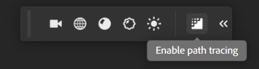

# Modo de rendimiento

El modo de rendimiento reúne todas las configuraciones que pueden ralentizar el flujo de trabajo: límites de resolución, sombras, calidad de desplazamiento y trazado de trazado. Apaga lo que no necesitas y consigue la capacidad de respuesta que deseas, sobre todo en hardware más ligero.

>[!NOTE]
>
> El modo de rendimiento se activa automáticamente con las limitaciones máximas si su hardware no cumple los [requisitos mínimos](../getting-started/system-requirements.md) de Sampler. Esto permite continuar usando Sampler en hardware menos potente.

## Conmutar el modo de rendimiento

El modo de rendimiento se puede alternar con el **botón de modo de rendimiento** situado en la parte superior derecha de la **ventana de Sampler**.

## Cambiar la configuración del modo Rendimiento

Use el menú desplegable junto al **botón de modo de rendimiento** para controlar los límites que habilita el modo de rendimiento.

| Configuración | Descripción |
| --- | --- |
| **Resolución máxima de vista previa** | El modo de rendimiento reduce la resolución de previsualización para un procesamiento más rápido. Esto no cambia la resolución de los activos importados o de su documento; en su lugar, esto cambia la calidad del procesador de la ventana gráfica. |
| **Deshabilitar calidad de desplazamiento** | Cuando esta configuración está habilitada, **Modo de rendimiento** bloquea el **valor de calidad del Desplazamiento** a 0, lo que deshabilita el efecto de desplazamiento en la ventana gráfica. Para materiales lisos como azulejos o telas finas, esto tiene un impacto visual mínimo, pero puede mejorar sustancialmente el rendimiento. |
| **Deshabilitar sombras** | Las mallas y los materiales desplazados pueden proyectar sombras, lo que crea una imagen más realista a costa del rendimiento. Con la opción **Deshabilitar sombras** activada, el modo Rendimiento desactiva todo el procesamiento de sombras, lo que mejora el rendimiento. |
| **Deshabilitar seguimiento de ruta** | El trazado de trazados es un potente método de procesamiento que sigue los trazados de luz a medida que rebotan en la escena y crea representaciones fotorrealistas. Sin embargo, el seguimiento de rutas es caro. Cuando la opción **Deshabilitar seguimiento de ruta** está activada, el modo Rendimiento desactiva la opción de activar el seguimiento de ruta en el **área de visualización 3D**. |

>[!NOTE]
>
> Se puede tener acceso al seguimiento de rutas desde la **barra de herramientas de la ventana gráfica 3D**.
>
> 
>
> Si el seguimiento de rutas no está habilitado, activar el modo Rendimiento con solo **Deshabilitar seguimiento de rutas** activado no tendrá ningún efecto.
