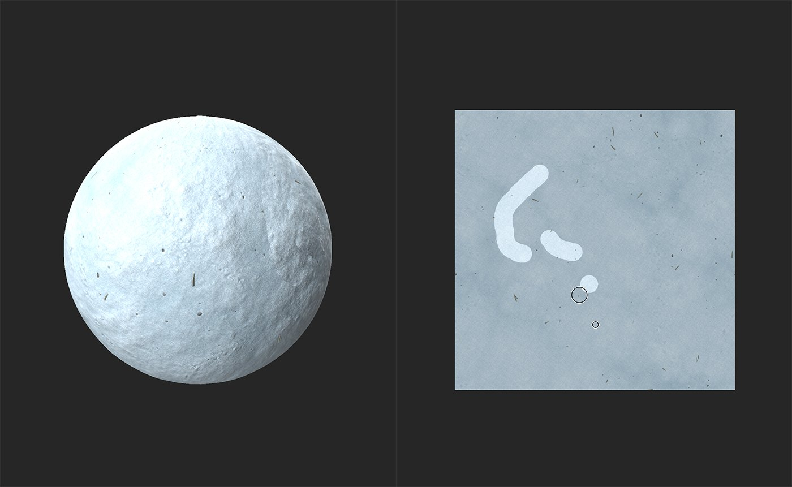
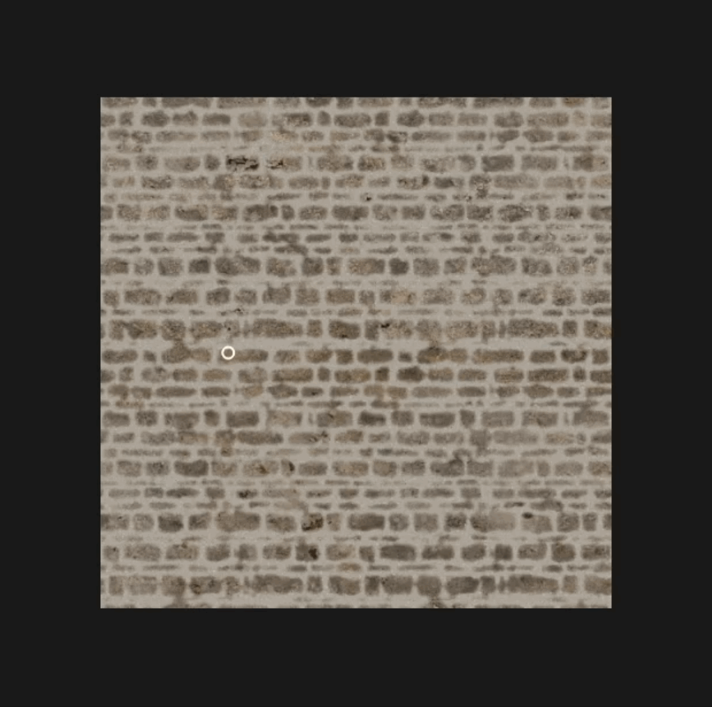

# Sello de Clonar

<table>
<tr style="border: 0;">
<td width="41.60%" style="border: 0;" valign="top">

**En:** Herramientas

</td>
<td width="58.30%" style="border: 0;" valign="top">

## Descripción

La herramienta **Sello de Clonar** te permite duplicar o parchear manualmente partes de tu material. Se utiliza principalmente para corregir costuras y eliminar errores de materiales escaneados, como escombros, sombras o artefactos. Puede pintura varios trazos de sello desde distintas áreas de origen dentro de una sola capa de sello de Clonar y administrar cada sello individualmente en el **panel Capas**.

En las imágenes que aparecen a continuación se muestra el **Sello de Clonar** que se está utilizando para eliminar los escombros de un material de nieve.

El material de nieve incluye una serie de ramitas y otros escombros dispersos alrededor.

Después de usar la herramienta **Sello de Clonar**, las ramitas se reemplazan por nieve limpia.

</td>
</tr>
</table>

## Parámetros

**Parámetros básicos**

* **Expandir máscara**: 0-1

  Ajuste la distancia alrededor del área pintada en la que el filtro intentará hacer coincidir el material subyacente.

* **Fusión de transición**: 0-1

  Suaviza el borde del área clonada para que se mezcle de forma más natural con el material circundante.

* **Desenfocar máscara**: 0-1

  Ajuste la cantidad de detalles de borde en el tampón de clonar. Los valores más altos producen bordes más suaves y más parecidos a los de una mancha.

* **Mantener proporción**: alternar

  Cuando está desactivada, permite ajustar las proporciones horizontales y verticales del área estampada de forma independiente.

  * **Horizontal**: 0-2
  * **Vertical**: 0-2
* **Rotación**: De -180 a 180

  Gire el área estampada para que coincida con la dirección o el granulado del material circundante.

* **Voltear horizontal**: alternar

  Reflejar el área estampada a lo largo de un eje horizontal.

* **Voltear verticalmente**: alternar

  Reflejar el área estampada a lo largo de un eje vertical.

**Fusión de transición**

Utilice los controles de fusión de fundido por canal para ajustar de forma independiente la intensidad de fusión de cada canal de material.

**Avanzado**

* **Intensidad normal**: 0-2

  Ajuste la intensidad del mapa de normales en el área estampada para controlar cómo reacciona la superficie clonada al alumbrado.

* **Posición de origen**:
  * Horizontal: 0-1: ajusta la posición horizontal del origen de clonación.
  * Vertical: 0-1: ajusta la posición vertical del origen de clonación.
* **Posición de destino**:
  * Horizontal: 0-1 — Ajusta la posición horizontal del objetivo de pintura.
  * Vertical: 0-1 — Ajusta la posición vertical del objetivo de pintura.
* **Modo de segmentación**: menú desplegable

  Habilite o deshabilite el mosaico al clonar cerca de los bordes de materiales.

## Cómo usar el sello del Clonar

1. Haz clic en **Sello de Clonar** en la barra lateral izquierda o añádelo desde el botón **Añadir una capa** en el **panel Capas**. Aparece una nueva capa de sello del Clonar en la parte superior de la pila de capas y **Vista 2D** se abre automáticamente.

1. **Establecer un punto de origen**: Mantenga presionado `Ctrl` (`Cmd` en macOS) y haga clic en un área limpia del material en el **Vista 2D**. Esto define la región que se copiará.

   > 📸 CAPTURA DE PANTALLA [ID: clone-stamp-001]
   > Mostrar: Ventana gráfica en 2D con una cruz de punto de origen visible en una zona limpia de un material de nieve
   > Estado: Clonar Sello capa seleccionada; Ctrl pulsado; indicador de origen visible
   > Anotación: Etiquetar la forma de cruz de origen

1. **Pintura sobre el área del problema**: Haga clic y arrastre el puntero sobre el área que desea corregir. El material del punto de origen reemplaza el área pintada en tiempo real.

   {width="300px"}

1. Ajusta **Fusionar fusión** y **Expandir máscara** en el **panel Propiedades** para ajustar la forma en que el área clonada se fusiona con su entorno.

>[!NOTE]
>
> Evite colocar el punto de origen cerca del área que está clonando. Si el origen se superpone al área problemática, el artefacto se puede clonar junto con el contenido limpio.

## Trabajar con varios orígenes

Puede añadir varios puntos de origen dentro de una sola capa de sello del Clonar, cada uno con su propia configuración de posición, rotación y fusión. Esto le permite corregir varias áreas diferentes (o dibujar a partir de varias regiones limpias diferentes) sin apilar varias capas.

Para agregar un nuevo origen, mantenga presionada la tecla `Ctrl` (`Cmd` en macOS) y haga clic en un área nueva en **Vista 2D**. Aparece una nueva entrada de sello debajo de la capa Sello de Clonar en el **panel Capas**.

> 📸 CAPTURA DE PANTALLA [ID: clone-stamp-002]
> Mostrar: El panel Capas con una capa de sello de Clonar expandida que muestra tres entradas de sello individuales anidadas debajo
> Estado: Clonar Sello capa expandida; tres sellos visibles con diferentes posiciones de origen
> Anotación: Flecha que señala a las entradas de sello anidadas en el panel Capas

Seleccione cualquier entrada de sello individual en el **panel Capas** para ajustar sus parámetros de forma independiente en el **panel Propiedades**, incluidos sus ajustes de posición, rotación y fusión de origen.

>[!TIP]
>
> Use la **vista previa del pincel** en el **Vista 2D** para ver el resultado del sello antes de confirmar un trazo. Esto le ayuda a comprobar que la región de origen coincide con el área circundante antes de pintar.

## Barra de herramientas

<table>
<tr style="border: 0;">
<td width="16.67%" style="border: 0;" valign="top">

</td>
<td width="83.33%" style="border: 0;" valign="top">

Mientras se selecciona una capa de sello de Clonar, aparece una barra de herramientas en **Vista 2D**.

* Seleccione **Herramienta Pincel** para agregarla a la máscara.
* Seleccione **Herramienta Borrar** para quitarla de la máscara.
* Defina el tamaño de la herramienta seleccionada actualmente.
* Acceder a controles adicionales:
  * **Mosaico de pincel**: Alternar el mosaico de pinceles X e Y.
  * **Superposición**: Alterne la visibilidad de la superposición al pasar el cursor sobre el Vista 2D.
* Ver **controles de Vista 2D**.

</td>
</tr>
</table>

>[!NOTE]
>
> Al igual que con otras barras de herramientas de la ventana gráfica, puede arrastrar el controlador situado en la parte superior de la barra de herramientas para cambiar su posición, hacer doble clic en el controlador para cambiar entre el diseño vertical y horizontal o utilizar el doble cursor para ocultarlo o expandirlo.

## Mét. abreviados

| Acción | Windows + Linux | macOS |
| --- | --- | --- |
| Aumentar tamaño de pincel | `]` o `Ctrl` + rueda del ratón | `]` o `Cmd` + rueda del ratón |
| Reducir tamaño de pincel | `[` o `Ctrl` + rueda del ratón | `[` o `Cmd` + rueda del ratón |
| Establecer el origen | `Ctrl` + clic izquierdo | `Cmd` + clic izquierdo |

## Relacionado

* [Deformar](./warp.md)
* [Convertir en mosaico](./make-it-tile.md)
* [De imagen a material](./image-to-material.md)
