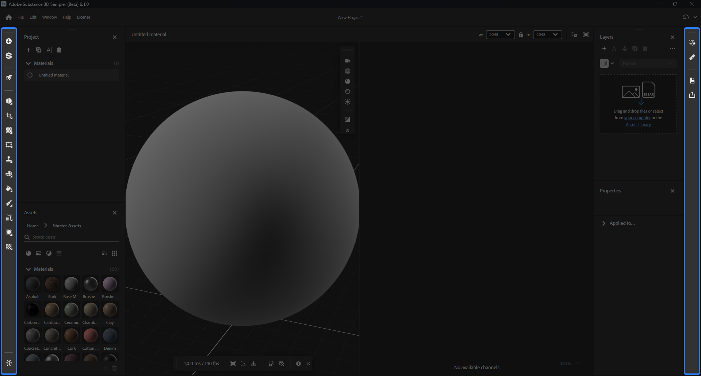

# Barras laterales

Sampler tiene dos barras laterales: **Barra lateral izquierda** y **Barra lateral derecha**.

## Barra lateral izquierda

Desde la **barra lateral izquierda**, puedes:

* **Agregar e importar contenido**: Importe imágenes y seleccione cómo se deben integrar en el proyecto.
* **Examinar activos 3D**: Accede a miles de materiales desde Substance 3D Assets en el escritorio de Creative Cloud.
* Accede a **Acciones rápidas**: Conjunto de acciones para alcanzar rápidamente determinados objetivos. [Más información sobre **Acciones rápidas &#x200B;**](../features-and-workflows/quick-actions.md)**.**
* Accede rápidamente a los filtros.
* Vuelva a abrir los siguientes paneles cuando estén cerrados:
  * El **panel Acciones rápidas**.
  * El **panel Proyecto**.
  * El **panel Activos**.
  * El **panel Configuración de canal**.

Para obtener más información sobre los filtros disponibles en la **barra lateral izquierda**, consulte [Herramientas y widgets](tools-and-widgets/tools-and-widgets.md).

## Barra lateral derecha

La **barra lateral derecha** contiene los siguientes paneles cuando están cerrados:

* El **panel Capas**.
* El **panel Propiedades**.
* El **Panel Parámetros expuestos**.
* El **panel Tamaño físico**.
* El **panel Metadatos**.
* El **panel Exportar**.

## Agregar filtros desde la barra lateral

La **barra lateral izquierda** proporciona acceso rápido a los filtros. Al pasar el ratón sobre un icono de filtro, se muestra el nombre del filtro y, al hacer clic en un filtro, se añadirá inmediatamente a la pila.

También puede hacer clic con el botón secundario en un filtro para ver una lista de filtros relacionados. Por ejemplo, haz clic con el botón derecho en el filtro **Mosaico** y podrás acceder a los filtros **Mosaico automático** y **Mosaico**.

>[!NOTE]
>
> Al usar el **menú contextual** para agregar un filtro, se reemplaza el filtro original de la **barra lateral** por el filtro usado más recientemente.
>
> Por ejemplo, en la animación siguiente, se muestra el **filtro Ecualizar**. Después de hacer clic con el botón derecho y agregar el **filtro Eliminador de plegado**, el **filtro Ecualizar** se reemplaza en la **barra lateral** por el **filtro Eliminador de plegado**.
>
> 

Se pueden agregar los siguientes filtros desde **Sidebar**:

<table>
  <tr style="border: 0;">
    <td style="border: 0;" valign="top"><ul><li><a href="../filters/adjustments/equalize.md">Ecualizar</a><ul><li><a href="../filters/adjustments/fold-remover.md">Eliminador de pliegues</a></li></ul></li><li><a href="../filters/tools/crop-tool.md">Herramienta Recortar</a><ul><li><a href="../filters/tools/perspective-correction.md">Corrección de perspectiva</a></li></ul></li><li><a href="../filters/tools/tiling.md">Mosaico</a><ul><li><a href="../filters/tools/auto-tiling.md">Mosaico automático</a></li><li><a href="../filters/tools/make-it-tile.md">Convertir en mosaico</a></li></ul></li><li><a href="../filters/tools/transform.md">Transformar</a><ul><li><a href="../filters/tools/warp.md">Deformar</a></li><li><a href="../filters/tools/warp-transform.md">Transformar deformación</a></li><li><a href="../filters/tools/perspective-correction.md">Perspectiva Transformar</a></li><li><a href="../filters/tools/paint-warp.md">Deformación de pintura</a></li></ul></li><li><a href="../filters/tools/clone-stamp.md">Sello de Clonar</a><ul><li><a href="../filters/tools/content-aware-fill.md">Relleno según el contenido</a></li></ul></li></ul></td>
    <td style="border: 0;" valign="top"><ul><li><a href="../filters/adjustments/color-variation.md">Variación de color</a><ul><li><a href="../filters/adjustments/colorize.md">Colorear</a></li><li><a href="../filters/adjustments/color-replace.md">Sustitución de color</a></li><li><a href="../filters/hdri-tools/color-temperature-adjustment.md">Color temperature adjustment</a></li></ul></li><li><a href="../filters/adjustments/fill.md">Relleno</a><ul><li><a href="../filters/tools/channel-switch.md">Conmutador de canal</a></li><li><a href="../filters/adjustments/invert.md">Invertir</a></li><li><a href="../filters/tools/height-to-ao.md">HEIGHT a AO</a></li></ul></li><li><a href="../filters/wear-and-finish/varnish.md">Abrigo y barniz</a><ul><li><a href="../filters/generators/embossing.md">Relieve</a></li><li><a href="../filters/generators/perforate.md">Perforar</a></li><li><a href="../filters/wear-and-finish/wood-finish.md">Acabado en madera</a></li><li><a href="../filters/wear-and-finish/metal-finish.md">Acabado Metálico</a></li></ul></li></ul></td>
    <td style="border: 0;" valign="top"><ul><li><a href="../filters/generators/embroidery.md">Bordado</a><ul><li><a href="../filters/generators/cloth-weave.md">Tejido de tela</a></li><li><a href="../filters/generators/quilt-stitch.md">Costura de tejido</a></li></ul></li><li><a href="../filters/wear-and-finish/dirt.md">Tierra</a><ul><li><a href="../filters/wear-and-finish/dust.md">Dust</a></li><li><a href="../filters/wear-and-finish/cracks.md">Grietas</a></li><li><a href="../filters/wear-and-finish/erode.md">Erosionar</a></li><li><a href="../filters/wear-and-finish/snow.md">Nieve</a></li><li><a href="../filters/wear-and-finish/water.md">Agua</a></li></ul></li><li><a href="../filters/tools/atlas-creator.md">Atlas Creator</a><ul><li><a href="../filters/tools/atlas-splitter.md">Atlas splitter</a></li><li><a href="../filters/generators/atlas-scatter.md">Atlas scatter</a></li></ul></li></ul></td>
  </tr>
</table>